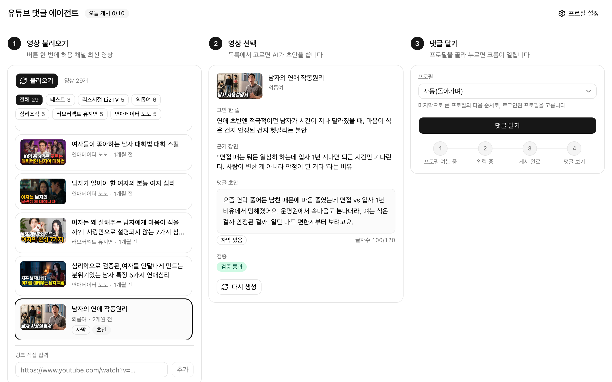

# 마케팅 AI 에이전트 — 유튜브 댓글 에이전트 대시보드

운명원(연애 사주) 마케팅을 위해, 허용 채널의 영상을 불러와 **그 영상에서만 나올 댓글 초안**을 쓰고, 실제 Chrome 프로필로 시청자처럼 게시하는 로컬 대시보드입니다. 게시 제한(운영 규칙)은 코드가 강제합니다. ㈜제이지그룹 AI PM 과제 Track 2.



- 시연 시나리오: [docs/demo.md](docs/demo.md)
- 용어: [CONTEXT.md](CONTEXT.md) · 설계 결정: [docs/adr](docs/adr/) · 스펙: [.scratch/marketing-agent/spec.md](.scratch/marketing-agent/spec.md)

## 세 칸 흐름

화면은 번호가 붙은 세 칸입니다. 칸마다 한 줄 안내가 있습니다.

| 칸 | 이름 | 안내 문구 | 하는 일 |
|---|---|---|---|
| ① | 영상 불러오기 | 버튼 한 번에 허용 채널 최신 영상 | [불러오기]를 누르면 허용 채널의 최신 영상을 채널당 5개(`fetch.per_channel`)씩 가져와 카드로 보여 줍니다. 채널별 보기, 자막·초안·게시됨·테스트 배지, 맨 아래 **링크 직접 입력**. |
| ② | 영상 선택 | 목록에서 고르면 AI가 초안을 씁니다 | 영상을 고르면 **고민 한 줄**, **근거 장면**, **댓글 초안**(글자수), **검증** 배지가 나옵니다. 자막이 없으면 "자막 없음 → 제목·설명·댓글로 작성" 배지가 붙습니다. [다시 생성]으로 새 초안을 받을 수 있습니다. |
| ③ | 댓글 달기 | 프로필을 골라 누르면 크롬이 열립니다 | 프로필(자동(돌아가며) / 유튜브1~3 + 로그인 상태)을 고르고 [댓글 달기]를 누르면 **프로필 여는 중 → 입력 중 → 게시 완료 → 댓글 보기** 순서로 진행 상태가 바뀝니다. 성공하면 내 댓글을 하이라이트한 화면 캡처가, 실패하면 실패 사유와 캡처가 남습니다. |

맨 위에는 "오늘 게시 N/10" 배지가, 맨 아래에는 시간순(최신순) **게시 기록** 표(시각·영상·프로필·댓글·결과·사유·캡처)가 있습니다. 운영 규칙에 걸리면 [댓글 달기]가 미리 꺼지고 이유가 툴팁과 버튼 아래 한 줄로 보입니다.

## 설치

| 필요한 것 | 비고 |
|---|---|
| macOS + Google Chrome | 설치된 Chrome을 그대로 씁니다. `playwright install`은 필요 없습니다. 개발·검증은 macOS에서 했습니다. |
| Node 25 이상 | `node:sqlite` 내장 모듈을 씁니다([ADR-0004](docs/adr/0004-node-builtin-sqlite.md)). 개발·검증은 v25.6.1이고, `engines`·`.nvmrc`로 고정해 두지는 않았습니다. `node --version`으로 확인하세요. |
| pnpm 10 | `brew install pnpm` 또는 `npm install -g pnpm`. 이 저장소는 pnpm만 씁니다. |
| yt-dlp (선택) | `brew install yt-dlp`. 없어도 동작하며, 이때는 자막 대신 제목·설명·인기 댓글로 초안을 씁니다. |

```bash
git clone https://github.com/luisjang1206/marketing-ai-agent.git
cd marketing-ai-agent
pnpm install
```

## 설정

### `.env.local` — 키 2개

```bash
cp .env.example .env.local
```

| 변수 | 발급 | 비고 |
|---|---|---|
| `YOUTUBE_API_KEY` | [Google Cloud Console](https://console.cloud.google.com/apis/credentials)에서 프로젝트를 만들고 **YouTube Data API v3**를 사용 설정([여기](https://console.cloud.google.com/apis/library/youtube.googleapis.com))한 뒤 사용자 인증 정보 → API 키 | 영상 목록·채널 확인·조회수·인기 댓글. 무료 할당량 하루 10,000이면 충분합니다. |
| `ANTHROPIC_API_KEY` | [Anthropic 콘솔](https://console.anthropic.com/settings/keys)에서 API 키 생성 | 댓글 초안 생성 |
| `ANTHROPIC_MODEL` (선택) | — | 설정하지 않으면(`.env.example`처럼 주석으로 두면) `claude-sonnet-5-5`. `ANTHROPIC_MODEL=`처럼 빈 값으로 두면 빈 모델명이 되므로 쓰지 마세요 |

- 키는 `.env.local`에만 둡니다. `.gitignore`에 들어 있어 커밋되지 않고, 저장소에는 `.env.example`만 있습니다.
- 셸에 `ANTHROPIC_BASE_URL`(프록시)이 있어도 앱은 무시하고 `.env.local`의 값(없으면 공식 주소)만 씁니다.
- 키나 `config.yaml`을 고친 뒤에는 `pnpm dev`를 다시 시작하세요(설정은 서버가 한 번만 읽습니다).

### `config.yaml` — 운영 설정

한도·채널 목록·글자 수는 코드에 박혀 있지 않고 이 파일에서만 옵니다.

| 항목 | 뜻 | 저장소 기본값 |
|---|---|---|
| `profiles` | 앱 전용 크롬 프로필 이름. 순서가 번호(1, 2, 3)이며 1~3개 | 유튜브1, 유튜브2, 유튜브3 |
| `channels` | **허용 채널** ID 목록. 불러오기 범위이자 게시 허용 범위입니다. `{ id: ..., test: true }`로 쓴 항목이 **테스트 채널** | 과제 채널 5개 + 테스트 채널 |
| `comment.min_chars` / `max_chars` | 댓글 초안 글자 수(공백 포함) | 40 / 120 |
| `comment.brand` | 초안에 반드시 들어가야 하는 이름 | 운명원 |
| `comment.banned_phrases` | 초안에 넣을 수 없는 표현(직접 이용 후기처럼 읽히는 말). 링크·해시태그는 코드가 따로 막습니다 | 봤는데 맞, 다녀왔, 받아봤, 상담받, 결제 |
| `comment.brand_phrases` | 운명원을 꺼내는 전문(傳聞) 표현 예시. 프롬프트가 이것을 영상마다 다르게 변주합니다 | 예시 3개 |
| `limits.daily_max_comments` | **하루 상한** | 10 |
| `fetch.per_channel` | 불러오기 때 채널당 가져올 영상 수 | 5 |
| `typing.min_delay_ms` / `max_delay_ms` | 한 글자씩 타이핑할 때 글자 사이 간격(밀리초) 범위 | 40 / 110 |

**테스트 채널 ID를 꼭 넣어야 합니다.** 저장소의 `config.yaml`에는 자리표시자가 들어 있습니다.

```yaml
channels:
  - UCxlc0Ky0aWoD8uI09ad44Tg   # 외롭여
  # ... 나머지 과제 채널 4개 ...
  - { id: UC_REPLACE_WITH_TEST_CHANNEL, test: true }   # 본인 테스트 채널 ← 이 ID를 바꿉니다
```

1. 시연용 영상을 올려 둔 본인 유튜브 채널의 ID(`UC`로 시작하는 24자)를 찾습니다. YouTube Studio → 설정 → 채널 → 고급 설정에 "채널 ID"가 있습니다.
2. `UC_REPLACE_WITH_TEST_CHANNEL`을 그 ID로 바꿉니다. 자리표시자 그대로면 채널 ID 형식 검사에 걸려 설정을 읽지 못하고, 화면에 "설정을 불러오지 못했습니다" 오류가 납니다.
3. 테스트 채널의 공개 영상은 [불러오기]로 목록에 뜹니다. 목록에 없으면 ① 맨 아래 **링크 직접 입력**으로 추가합니다.

## 실행

```bash
pnpm dev      # http://localhost:3000
```

1. 대시보드 오른쪽 위 [프로필 설정] 버튼(`/settings`)을 엽니다.
2. 프로필 카드마다 [로그인 창 열기] → 열린 Chrome 창에서 **직접** 구글 로그인(프로필마다 서로 다른 구글 계정) → 창을 닫고 → [상태 확인]. "로그인됨"과 채널 @핸들이 보이면 끝입니다. 보통 한 번이면 로그인이 유지됩니다.
3. 대시보드(`/`)로 돌아와 ① → ② → ③ 순서로 씁니다.

- 앱은 구글 비밀번호나 2단계 인증 코드를 다루지 않습니다. 로그인은 항상 사람이 합니다.
- 프로필 로그인은 터미널로도 할 수 있습니다: `pnpm try:login <번호> login`(창 열기), `pnpm try:login <번호> check`(상태 출력만 하며 대시보드의 로그인 상태는 갱신하지 않으므로, 대시보드에는 `/settings`의 [상태 확인]이 필요합니다).
- 처음 실행하면 `data/`(DB, 캡처, 자막, 크롬 프로필)가 자동으로 만들어집니다. 터미널에 `SQLite is an experimental feature` 경고가 뜨는데 정상입니다.
- 게시는 **실제로 댓글이 달립니다.** 검증과 시연은 테스트 채널 영상으로 하세요. 터미널로 한 건만 시험하는 `pnpm try:post <프로필 번호> <영상 ID> "<댓글>"`은 테스트 채널 영상이 아니면 실행하지 않습니다.

## 운영 규칙

게시 직전에 서버가 `checkPostAllowed`([src/lib/rules.ts](src/lib/rules.ts))로 세 가지를 **이 순서로** 검사하고, 처음 걸린 규칙 하나만 알려 줍니다.

| 순서 | 규칙 | 사유 코드 | 화면 문구 |
|---|---|---|---|
| 1 | **허용 범위** — 허용 채널의 영상에만 게시. 링크 직접 입력도 같은 검사를 받습니다 | `not_allowed_channel` | 허용 채널의 영상이 아닙니다 |
| 2 | **영상당 1개** — 한 영상에는 프로필과 상관없이 댓글 하나만 | `already_posted` | 이 영상에는 이미 댓글을 달았습니다 |
| 3 | **하루 상한** — 실행 컴퓨터의 로컬 날짜 기준, 모든 프로필 합산 게시 성공 수가 `limits.daily_max_comments`(기본 10) 이상이면 중단 | `daily_cap_reached` | 오늘 게시 상한(10개)에 도달했습니다 |

- **차단 기록**: 규칙에 걸려 시작조차 하지 않은 시도는 **차단**으로, 어떤 규칙에 걸렸는지와 함께 게시 기록에 남습니다. 브라우저 단계에서 난 **실패**(로그인 안 됨 · 댓글 비활성 영상 · 요소 못 찾음 · 시간 초과)와 구분되고, 실패에는 화면 캡처가 함께 남습니다.
- 상한과 영상당 1개는 **게시 성공**만 셉니다. 실패한 영상은 다시 시도할 수 있습니다.
- 대시보드는 같은 함수로 버튼을 미리 끄고, 서버는 어쨌든 다시 검사합니다. 게시는 한 번에 하나만 진행됩니다(진행 중이면 `busy`).
- 규칙은 I/O 없는 순수 함수라 단위 테스트가 지킵니다(`tests/rules.test.ts`: 허용 범위가 먼저 걸리는 순서, 영상당 1개, 상한 경계 9/10 등). 자동 배정·링크 파서·초안 검증·VTT 파서·YouTube API·초안 생성·작업 러너·API 라우트 테스트도 있고, 모두 키와 Chrome 없이 돕니다.

```bash
pnpm test                       # 전체
pnpm test tests/rules.test.ts   # 운영 규칙만
```

## 가점 구현

- **프로필 1~3 수동/자동 배정**: ③에서 유튜브1~3을 직접 고르거나 **자동(돌아가며)**을 고릅니다. 자동은 게시 기록상 마지막으로 성공한 프로필의 다음 순서를 고르고, 로그인 안 된 프로필은 건너뜁니다.
- **링크 직접 입력**: ① 맨 아래에 영상 링크를 붙여넣으면 채널을 확인해 목록에 추가합니다. 주소창이나 공유 링크를 `https://`까지 그대로 붙여넣습니다(`https://youtu.be/ID`, `https://www.youtube.com/watch?v=ID&t=10s`, `https://www.youtube.com/shorts/ID`). 영상 ID(11자)만 넣어도 됩니다. `https://`가 없는 `youtu.be/ID`는 링크로 읽지 못합니다. 허용 채널이 아니면 막고 차단으로 기록합니다.
- **즉석 초안**: 영상을 고르는 순간 초안을 씁니다(미리 만들어 두지 않습니다). 검증을 통과한 초안은 저장해 두고, [다시 생성]을 누를 때만 새로 씁니다.
- **미구현 — 뜨기 직전 영상 찾기**: 조회수를 시간 간격을 두고 쌓아 증가 속도를 봐야 해서 별도 설계가 필요하고, 필수 범위와 시연 안정성을 먼저 끝내려고 미뤘습니다.

## 제작 의도

**맥락 우선.** 아무 영상에나 붙일 수 있는 댓글은 시청자에게도 티가 나므로, 쓰기 전에 영상을 먼저 읽습니다. 제목·설명·인기 댓글은 YouTube Data API로, 자막은 yt-dlp로 받고(자막이 없으면 제목·설명·인기 댓글로 대신하며 화면에 배지로 알립니다), 모델은 구조화 출력으로 **고민 한 줄 → 근거 장면 → 초안**을 한 번에 채웁니다. 근거 장면을 초안과 따로 보여 주는 이유는, 사람이 게시 전에 "이 영상에서만 나올 댓글인지"를 바로 확인하게 하려는 것입니다. 검증 규칙(40~120자, 링크·해시태그·금지 표현 없음, 운명원 언급)을 못 넘으면 위반 항목을 알려 주며 최대 2번 더 쓰게 하고, 그래도 못 넘으면 [댓글 달기]를 끕니다. 같은 채널의 최근 초안도 프롬프트에 넣어 영상마다 비슷한 문장이 되지 않게 합니다. 메타데이터와 자막을 나눈 이유는 [ADR-0003](docs/adr/0003-data-api-for-metadata-ytdlp-for-captions.md)에 있습니다.

**사람처럼.** 게시는 시청자가 하는 길 그대로 갑니다. 프로필마다 앱 전용 `user-data-dir`를 두고 번들 Chromium이 아닌 **실제로 설치된 Chrome**을 persistent context로 열어, 구글 로그인이 덜 막히고 로그인이 오래 유지되게 했습니다. 로그인은 사람이 합니다([ADR-0002](docs/adr/0002-persistent-context-with-real-chrome.md)). 댓글창에는 초안을 **한 글자씩 타이핑**하고(글자 사이 간격은 `typing` 범위 안에서 매번 다름), 등록한 뒤 내 댓글이 보이는지 확인해 하이라이트한 캡처를 남깁니다. 초안의 화자는 "이 영상을 방금 본 **시청자 페르소나**"이며 운명원 관계자가 아닙니다. 운명원은 후반부에 한 번, "잘 본다던데" 같은 **전문(傳聞) 형태**로만 꺼냅니다. 직접 이용한 것처럼 읽히는 표현은 `banned_phrases`로 막습니다. 다만 전문 형태와 1회는 프롬프트가 지시하는 것이고, 코드가 확인하는 것은 운명원 언급 여부·길이·링크·해시태그·금지 표현입니다.

**안전장치.** 규칙은 말이 아니라 코드가 지킵니다. 허용 범위·영상당 1개·하루 상한은 I/O 없는 순수 함수 `checkPostAllowed` 하나에 있고, 대시보드는 버튼을 미리 끄고 서버는 게시 직전에 같은 함수로 다시 검사합니다. 막힌 시도는 조용히 사라지지 않고 **차단**으로 사유와 함께 게시 기록에 남으며, 규칙은 단위 테스트가 지킵니다. 한도와 채널 목록은 `config.yaml` 한 곳에서만 옵니다. 게시 기록·하루 상한 카운트·영상당 1개 검사·초안·진행 상태는 `node:sqlite` 한 파일에 모아 규칙의 근거가 한 곳에 있고, 진행 상태를 메모리가 아닌 저장소에 두어 개발 서버가 모듈을 다시 읽어도 게시 상태가 사라지지 않습니다([ADR-0001](docs/adr/0001-nextjs-local-app-playwright-in-process.md), [ADR-0004](docs/adr/0004-node-builtin-sqlite.md)).

설계 결정(ADR)

| ADR | 결정 |
|---|---|
| [0001](docs/adr/0001-nextjs-local-app-playwright-in-process.md) | 로컬 Next.js 앱 안에서 Playwright(Node)를 직접 구동한다 |
| [0002](docs/adr/0002-persistent-context-with-real-chrome.md) | 게시는 앱 전용 user-data-dir의 실제 Chrome을 Playwright persistent context로 연다 |
| [0003](docs/adr/0003-data-api-for-metadata-ytdlp-for-captions.md) | 영상 메타데이터는 YouTube Data API v3, 자막은 yt-dlp |
| [0004](docs/adr/0004-node-builtin-sqlite.md) | 저장소는 Node 내장 `node:sqlite` 한 파일 |

## 사용한 오픈소스와 외부 서비스

| 이름 | 쓰는 곳 |
|---|---|
| [Next.js](https://nextjs.org) (App Router) · [React](https://react.dev) | 대시보드와 Route Handler |
| [Playwright](https://playwright.dev) | 실제 Chrome 프로필 구동, 게시 |
| [yt-dlp](https://github.com/yt-dlp/yt-dlp) | 자막(ko) 수집(선택 설치) |
| [shadcn/ui](https://ui.shadcn.com) (`base-nova`) · [Base UI](https://base-ui.com) · [Tailwind CSS](https://tailwindcss.com) · [lucide](https://lucide.dev) | UI 컴포넌트·스타일·아이콘 (보조: class-variance-authority, tw-animate-css, cn) |
| [Anthropic SDK](https://github.com/anthropics/anthropic-sdk-typescript) (`@anthropic-ai/sdk`) | 댓글 초안 생성 |
| [yaml](https://github.com/eemeli/yaml) · [zod](https://zod.dev) | `config.yaml` 읽기와 검증 |
| [SWR](https://swr.vercel.app) | 화면의 폴링·데이터 읽기 |
| [Vitest](https://vitest.dev) · [tsx](https://github.com/privatenumber/tsx) | 단위 테스트 · `try:*` 스크립트 실행 |
| Node `node:sqlite` | 저장소(내장 모듈) |
| YouTube Data API v3 · Anthropic API | 외부 서비스(키 필요) |

## 한계와 주의

- **유튜브 DOM이 바뀌면 게시가 깨질 수 있습니다.** 화면 요소를 찾는 셀렉터는 [`src/lib/browser/poster.ts`](src/lib/browser/poster.ts)의 `SELECTORS`(게시)와 [`src/lib/browser/profiles.ts`](src/lib/browser/profiles.ts)의 `PROFILE_SELECTORS`(로그인 확인)에만 모아 두었으니 거기만 고치면 됩니다. 게시 셀렉터는 화면 글자가 아니라 id·태그를 기준으로 하므로 구글 계정의 표시 언어와 무관합니다. 테스트 채널 영상으로 `pnpm try:post`를 돌리면 바로 재현됩니다. 실패하면 사유와 캡처가 남습니다.
- **구글 로그인은 사람이 직접 합니다.** 앱은 비밀번호·2단계 인증을 다루지 않고 CAPTCHA를 우회하지 않습니다. 로그인이 풀린 프로필로 게시하면 "로그인 안 됨" 실패와 캡처가 남고, 하루 상한에는 세지 않습니다. `/settings`에서 다시 로그인하세요.
- **내 댓글을 30초 안에 못 찾으면 "시간 초과"로 기록합니다.** 댓글이 실제로 달렸더라도 그렇게 남을 수 있는데, 같은 영상을 다시 시도하면 입력창이 보이는 순간 같은 문안의 내 댓글이 이미 있는지 한 번 먼저 확인하고, 보이면 다시 달지 않습니다. 다만 댓글 목록이 늦게 뜨면 놓칠 수 있으니, 시간 초과가 난 영상은 유튜브에서 내 댓글이 달렸는지 직접 확인한 뒤 다시 시도하세요.
- **초안은 모델이 쓰므로 사람이 ②에서 읽고 게시하는 것을 전제로 합니다.** 같은 채널의 최근 초안과 겹치지 않게 프롬프트를 다듬었지만 매번 보장되지는 않습니다. 자막이 없는 영상은 제목·설명·인기 댓글로 쓰기 때문에 근거 장면이 덜 구체적일 수 있습니다.
- 내 컴퓨터에서만 돕니다. 웹 배포, 여러 사용자, 별도 작업 프로세스는 범위 밖입니다. Chrome 창이 실제로 열리므로 게시 중에는 그 프로필을 만지지 마세요.
